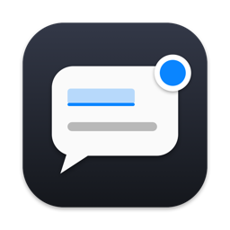
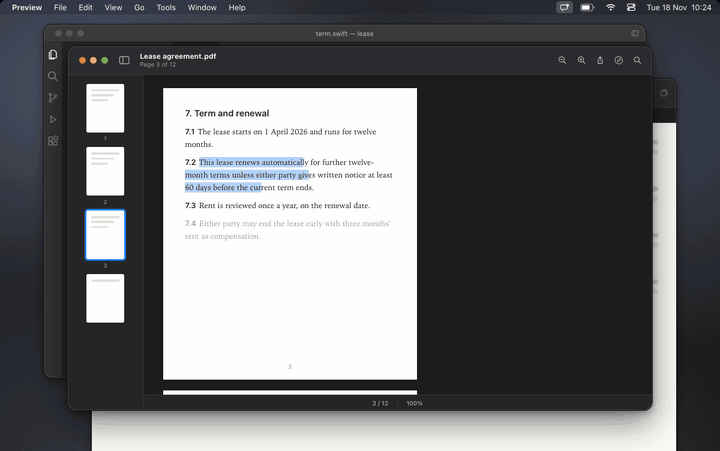

<p align="center">
  
</p>

<h1 align="center">Margem</h1>

<p align="center">Comments you pin to any spot in any app on your Mac,<br>with Claude or ChatGPT answering right there.</p>

<p align="center">
  
  <br><sub>A drawing of the app, from Margem's page. The answer was written for it.</sub>
</p>

## Install

In Terminal:

```sh
curl -fsSL https://github.com/gabrielmouallem/margem-releases/releases/latest/download/install.sh | sh
```

It downloads `Margem.zip` from the latest release, checks its SHA-256 and its signature, puts Margem in Applications and opens it. Nothing else: no password, no other files. [Read the script](install.sh) first.

Or let Claude Code do it: paste *"Install Margem on this Mac by running: curl -fsSL https://github.com/gabrielmouallem/margem-releases/releases/latest/download/install.sh | sh"*.

<details>
<summary>Downloading in a browser instead</summary>

Margem is not notarized by Apple yet, so your Mac stops a copy that came from a browser the first time.

1. Unzip it, drag Margem to Applications and open it. When your Mac says it can't check Margem, click **Done**.
2. Within the hour, open System Settings › Privacy & Security, scroll to Security and click **Open Anyway** next to Margem.
3. Click **Open** on the next warning and enter your Mac's password.

On macOS 14, Control-click Margem and choose Open. No Open Anyway button? This takes the browser's mark off Margem only:

```sh
xattr -dr com.apple.quarantine /Applications/Margem.app
```
</details>

## What it does

- **Point and press ⌃⌥M**, or select text and click the +. The note stays on that spot: a passage, a button, a file, a moment in a video.
- **Ask in place.** Claude or ChatGPT answers inside the note, with the spot and the text around it. Uses Claude Code or Codex already signed in on your Mac.
- **Find it again** from Spotlight or the menu bar; Margem opens the page at the passage, the video at the minute, the code at the line.
- **Local.** Your comments live in one file on your Mac. No account.

## Price

Free for 14 days, everything on. Then $19 once, no subscription. If you don't buy, your notes stay and still open.

macOS 14 or later, on a Mac with Apple silicon.

---

This repository only holds Margem's release files. The app's source is private.
